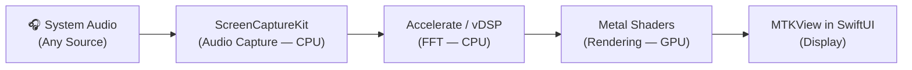
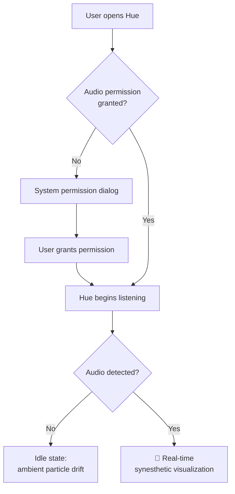

# Product Requirements Document

<table>
<tr><td><strong>Project Name</strong></td><td>Hue — Synesthesia Simulator</td></tr>
<tr><td><strong>Platform</strong></td><td>macOS (Native)</td></tr>
<tr><td><strong>Version</strong></td><td>1.0</td></tr>
<tr><td><strong>Status</strong></td><td>🟢 Active — Ideation Phase</td></tr>
<tr><td><strong>Last Updated</strong></td><td>2026-07-23</td></tr>
<tr><td><strong>Author</strong></td><td>—</td></tr>
</table>

---

## 1. Executive Summary

**Hue** is a native macOS application that visualizes system audio in real-time as generative GPU art. Rather than functioning as a standard equalizer visualizer, Hue acts as a scientifically grounded simulator for **chromesthesia** — a form of synesthesia in which sounds involuntarily trigger the perception of color.

By intercepting raw system audio and routing it through a custom **Metal** graphics pipeline, the app translates audio frequencies, timbres, and amplitudes into fluid, organic visuals — allowing users to literally *see* the music playing on their Mac.

### Why Build This?

| Problem | Hue's Answer |
|---|---|
| Existing audio visualizers are cosmetic — they animate bars to a beat with no scientific basis. | Hue's rendering engine is grounded in published synesthesia research, mapping frequency → hue, waveform → texture, and amplitude → scale. |
| Most visualizers require complex audio routing (e.g., Soundflower, BlackHole). | Hue uses Apple's native `ScreenCaptureKit` to tap system audio with zero third-party dependencies. |
| GPU-accelerated, shader-driven music visualization is locked behind professional VJ software. | Hue ships as a single, frictionless `.app` — drag, drop, grant permissions, play music. |

---

## 2. Scientific Foundation

To authentically simulate chromesthesia, the visual rendering engine operates on three core neurological mappings backed by synesthesia research:

### 2.1 Pitch → Lightness & Hue *(Frequency Mapping)*

Lower frequencies (bass) map to deep, heavy colors — indigos, violets, and deep reds. Higher frequencies (treble) map to bright, high-lightness colors — yellows and whites. This mirrors the cross-modal "luminance–pitch" correspondence documented in both synesthetes and non-synesthetes (Marks, 1974; Ward et al., 2006).

### 2.2 Timbre → Texture *(Waveform Mapping)*

The harmonic complexity of the sound wave alters the 3D geometry of rendered shapes:

- **Pure / smooth tones** → fluid, glassy, rounded surfaces.
- **Complex / distorted tones** → geometric roughness, fractured edges, and particle scattering.

### 2.3 Loudness → Scale *(Amplitude Mapping)*

Volume dictates physical presence in the visual field:

- **Crescendos** → expanding, intensifying color fields with increased physical displacement.
- **Pianissimos** → contracted, subtle, almost transparent forms.

---

## 3. Core Features

### 3.1 Global Audio Intercept

Works natively with **any** audio source playing on the Mac — Spotify, Apple Music, YouTube in Safari, DAWs, video calls — without requiring third-party audio routing drivers.

### 3.2 Zero-Latency Rendering

Audio is processed and rendered at **60 frames per second**. The entire pipeline runs locally on-device. No network calls, no external APIs, no perceptible delay between sound and visual response.

### 3.3 Generative Fluid Dynamics

Rejects classic "EQ bars" entirely. Visuals are organic, shader-driven forms — blobs, ribbons, particle fields, and flowing color gradients — that mimic the organic nature of human perception. Every frame is procedurally generated; no two visual moments are identical.

### 3.4 Frictionless Setup

Packaged as a standard macOS `.app` bundle. The only setup required:

1. Drag to `/Applications`.
2. Grant **Screen & Audio Recording** permission on first launch.
3. Play music. See it.

---

## 4. Technical Architecture

The app is built entirely within the Apple ecosystem for maximum performance. The architecture cleanly separates **CPU-side data crunching** from **GPU-side rendering** across four layers:

### 4.1 Audio Capture Layer — CPU

| | |
|---|---|
| **Framework** | `ScreenCaptureKit` |
| **Purpose** | Taps into the global system audio output buffer without requiring a virtual audio device. |
| **Output** | Raw `CMSampleBuffer` audio frames delivered via `SCStreamOutput` delegate. |
| **Permissions** | Requires `Screen & System Audio Recording` entitlement (user-granted on first launch). |

### 4.2 Digital Signal Processing Layer — CPU

| | |
|---|---|
| **Framework** | `Accelerate.framework` (`vDSP`) |
| **Purpose** | Performs a **Fast Fourier Transform (FFT)** on raw audio waveforms, converting time-domain samples into actionable frequency-domain data. |
| **Output** | Frequency bin arrays (bass, mids, treble) and total RMS amplitude — updated per frame. |
| **Performance** | Hardware-accelerated SIMD operations via Apple's Accelerate framework. |

### 4.3 Visual Engine — GPU

| | |
|---|---|
| **Framework** | `Metal` & `Metal Shading Language (MSL)` |
| **Purpose** | A custom vertex + fragment shader pipeline that ingests FFT data arrays and calculates pixel colors, geometry deformation, and particle physics directly on the GPU. |
| **Key Techniques** | Signed distance fields (SDFs), noise functions (Perlin/Simplex), fluid simulation kernels. |
| **Performance Target** | Sustained **60 FPS** at native display resolution. |

### 4.4 Application Wrapper — UI

| | |
|---|---|
| **Framework** | `SwiftUI` |
| **Purpose** | Handles the main application window, system permission prompts, and hosts the `MTKView` Metal rendering surface via `NSViewRepresentable`. |
| **Scope** | Minimal chrome. The visual output *is* the UI. |

---

## 5. User Experience

### 5.1 First Launch Flow

### 5.2 Primary Interaction

The primary interaction is **passive** — the user plays music and watches. Hue's window acts as a living canvas that reacts to whatever audio is playing on the system. No buttons, no sliders, no configuration required for the core experience.

---

## 6. Development Phases

### Phase 1 — The Audio Tap *(Plumbing)*

> **Goal:** Prove that the app can capture system audio.

- Initialize an Xcode macOS project targeting macOS 14+.
- Implement `ScreenCaptureKit` stream with audio-only configuration.
- Bypass the video feed entirely (audio-only capture).
- Print raw audio buffer metadata to console to validate the pipeline.

**Exit Criteria:** Raw `CMSampleBuffer` frames are logged to console while Spotify plays.

---

### Phase 2 — The Math *(DSP)*

> **Goal:** Transform raw audio into structured frequency data.

- Route the raw audio buffer into the `Accelerate` framework.
- Implement FFT using `vDSP_fft_zrip` or equivalent.
- Extract frequency bin magnitudes across bass (20–250 Hz), mids (250–4000 Hz), and treble (4000–20000 Hz) ranges.
- Calculate RMS amplitude for overall loudness.

**Exit Criteria:** Console prints live frequency arrays and amplitude values that respond in real-time to music.

---

### Phase 3 — The Canvas *(Graphics)*

> **Goal:** Render a Metal surface inside a SwiftUI window.

- Set up `MTKView` (Metal Kit View) and wrap it with `NSViewRepresentable` for SwiftUI.
- Implement a basic `MTLRenderPipelineState` with pass-through vertex/fragment shaders.
- Render a test gradient to validate the GPU pipeline.
- Wire FFT data arrays into a shared `MTLBuffer` for shader access.

**Exit Criteria:** A SwiftUI window displays a live Metal-rendered surface with test visuals.

---

### Phase 4 — The Art *(Shaders)*

> **Goal:** Bring the synesthesia simulation to life.

- Write MSL vertex + fragment shaders that consume the FFT buffer.
- Implement the three core mappings:
  - **Frequency → Hue/Lightness** via HSL color space transformations.
  - **Waveform complexity → Surface roughness** via noise displacement.
  - **Amplitude → Scale/Intensity** via uniform scaling and bloom.
- Add fluid dynamics simulation (advection, diffusion) for organic motion.
- Polish with temporal smoothing to prevent visual jitter.

**Exit Criteria:** Playing different genres of music produces visually distinct, beautiful, and responsive generative art.

---

## 7. Requirements Summary

### Functional Requirements

| ID | Requirement | Priority |
|---|---|---|
| FR-01 | Capture system-wide audio from any application without third-party drivers. | P0 |
| FR-02 | Perform real-time FFT to extract frequency bins and amplitude. | P0 |
| FR-03 | Render generative visuals at 60 FPS via Metal shaders. | P0 |
| FR-04 | Map audio frequency to color hue/lightness. | P0 |
| FR-05 | Map waveform complexity to visual texture/geometry. | P1 |
| FR-06 | Map amplitude to visual scale and intensity. | P0 |
| FR-07 | Display an ambient idle state when no audio is detected. | P1 |

### Non-Functional Requirements

| ID | Requirement | Target |
|---|---|---|
| NFR-01 | Frame rate | Sustained 60 FPS at native resolution |
| NFR-02 | Audio-to-visual latency | < 16 ms (single frame) |
| NFR-03 | CPU usage during playback | < 15% on Apple Silicon |
| NFR-04 | Memory footprint | < 150 MB resident |
| NFR-05 | Minimum macOS version | macOS 14 (Sonoma) |
| NFR-06 | App launch to first visual | < 3 seconds |

---

## 8. Risks & Mitigations

| Risk | Impact | Likelihood | Mitigation |
|---|---|---|---|
| `ScreenCaptureKit` permission UX may confuse users. | Medium | Medium | Provide clear onboarding UI explaining why the permission is needed. |
| FFT resolution may be insufficient for nuanced timbre detection. | Medium | Low | Use a 4096-sample FFT window and experiment with overlapping windows. |
| Metal shader complexity could drop below 60 FPS on older Intel Macs. | High | Medium | Profile early on target hardware; implement LOD (level-of-detail) fallbacks. Consider Apple Silicon–only release. |
| Apple may restrict `ScreenCaptureKit` audio access in future macOS versions. | High | Low | Monitor WWDC announcements; abstract the audio capture layer for future swap-ability. |

---

## 9. Success Criteria

The v1.0 release is considered successful if:

1. **Technical:** The app captures system audio and renders synesthetic visuals at 60 FPS with < 16 ms latency on Apple Silicon Macs.
2. **Experiential:** Playing three distinct genres (classical, electronic, hip-hop) produces visually distinct, aesthetically compelling outputs.
3. **Usability:** A new user can go from download → first visual in under 30 seconds with no documentation.

---

## 10. Future Considerations *(Post v1.0)*

These are explicitly **out of scope** for v1.0 but worth noting for future iterations:

- **User-configurable color palettes** — let users define their own frequency-to-color mappings.
- **Preset visual modes** — curated shader presets (e.g., "Nebula", "Ocean", "Crystal").
- **Screenshot & video export** — capture the visualization as a video or still image.
- **Audio source picker** — choose a specific app's audio instead of system-wide capture.
- **Screensaver mode** — register Hue as a native macOS screensaver.
- **Microphone input** — live visualization of ambient or instrument audio.

---

> *This document is a living specification. It will be updated as the project moves through ideation, development, and testing.*
