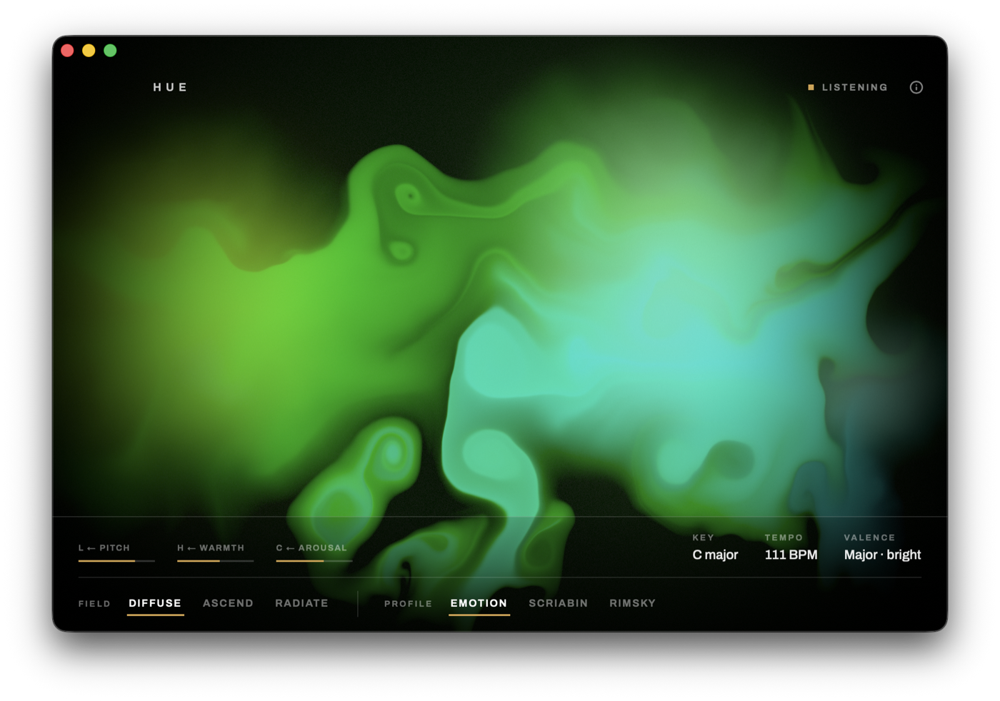
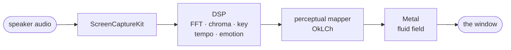
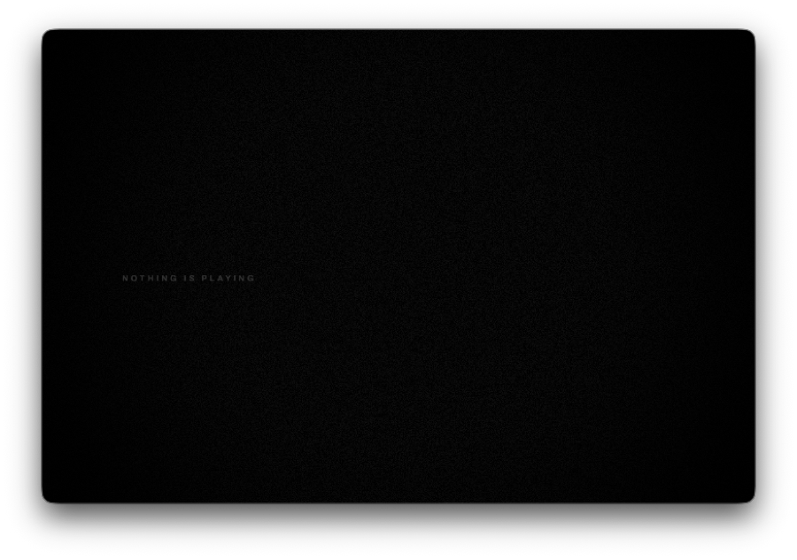

<p align="center">
  
</p>

<p align="center">
  <b>Whatever is playing on your Mac, painted in real time.</b><br>
  <sub>Spotify, a film, a game, a podcast. Hue listens to the sound already leaving your speakers and turns it into a live field of colour on the GPU. Nothing leaves the machine.</sub>
</p>

<p align="center">
  <sub>
    <a href="#overview">OVERVIEW</a> &nbsp;·&nbsp;
    <a href="#setup">SETUP</a> &nbsp;·&nbsp;
    <a href="#how-it-works">HOW IT WORKS</a> &nbsp;·&nbsp;
    <a href="#reading-the-colours">READING THE COLOURS</a> &nbsp;·&nbsp;
    <a href="#fields-and-profiles">FIELDS AND PROFILES</a> &nbsp;·&nbsp;
    <a href="#privacy">PRIVACY</a>
  </sub>
</p>

<br>

<p align="center">
  
</p>

<table>
  <tr>
    <td><sub>PLATFORM</sub><br><b>macOS 14 Sonoma+</b></td>
    <td><sub>CAPTURE</sub><br><b>ScreenCaptureKit, audio only</b></td>
    <td><sub>COLOUR SPACE</sub><br><b>OkLCh</b></td>
    <td><sub>RENDER</sub><br><b>Metal fluid simulation</b></td>
    <td><sub>VIRTUAL CABLES</sub><br><b>None needed</b></td>
  </tr>
</table>

## Overview

Hue is modelled on **chromesthesia**, the form of synesthesia in which sound involuntarily produces colour, and on research into how everyone else links music and colour.

The findings are surprisingly consistent across people, and Hue implements them honestly instead of chasing the beat with a random palette.

## Setup

1. Open **Hue.app** from Applications.
2. When macOS asks for **Screen & Audio Recording**, allow it. Hue only reads the audio leaving your speakers.
3. Play music.

No BlackHole, no Soundflower, no account, no network.

> [!NOTE]
> While Hue listens, macOS shows its purple recording indicator. Apple owns that indicator and no app can hide it. Closing Hue's window stops capture.

## How it works



| The music | drives | What you see |
|---|---|---|
| Pitch height | → | **Lightness.** Higher sounds are lighter. The backbone. |
| Mood: major and happy, or minor and sad | → | **Hue.** Happy pulls warm, sad pulls cool. |
| Energy: loud, fast, bright | → | **Saturation.** Vivid when intense, muted when soft. |
| Tempo and beats | → | **Motion.** Fast music pushes harder; calm music leaves longer trails. |

> [!IMPORTANT]
> **Why OkLCh.** Lightness is the backbone of the mapping, so "lighter" must mean *perceived* lighter, which HSL does not give you. In a perceptually uniform space, an equal change in the music looks like an equal change on screen.

## Reading the colours

<table>
  <tr>
    <td width="50%" valign="top">
      <br>
      <sub><b>Silence.</b> Near-black is not a dark colour. It means nothing is playing, and what is left decays away.</sub>
    </td>
    <td width="50%" valign="top">
      <br>
      <sub><b>One continuous path.</b> Deep blue, cyan, green, warm yellow.</sub>
    </td>
  </tr>
</table>

| When the music feels | the colour tends toward |
|---|---|
| Low, minor, quiet | deep slate blue |
| Low, minor, loud and fast | electric cyan |
| Mid, ambiguous, moderate | green |
| High, major, energetic | warm yellow and gold |
| High, soft, slow | pale yellow-green |

The meters show what Hue is hearing right now: pitch, warmth, arousal, and the detected key, tempo and valence.

## Fields and profiles

**Fields** decide how the paint moves.

| Field | Feel |
|---|---|
| **Diffuse** | Ink loosed in still water |
| **Ascend** | Rising veils; higher pitches sit higher |
| **Radiate** | Pressure from the centre; beats push rings outward |

**Profiles** decide which colour story to tell.

| Profile | What it is |
|---|---|
| **Emotion** | The default. Population-level research. |
| **Scriabin** | One composer's private 1911 note-to-colour wheel |
| **Rimsky** | Rimsky-Korsakov's key-to-colour associations, which disagree with Scriabin, which is the point |

The composer wheels are curiosities, not claims about how the brain works.

## Everyday use

| To | Do |
|---|---|
| Reveal the controls | Move the pointer into the window |
| Keep it in a corner | Open the always-on-top mini window from the menu bar |
| Learn the system | The small **i** at the top right |
| Quit | Close the window, or <kbd>⌘</kbd><kbd>Q</kbd> |

## Privacy

Hue listens to system audio output and nothing else. It does not capture or save your screen, does not store the music, has no account, and never phones home.

<details>
<summary><b>Building from source</b> (copyright holder or written permission only)</summary>
<br>

```bash
cd hue
./regenerate_project.sh
DEVELOPER_DIR=/Applications/Xcode.app/Contents/Developer \
  xcodebuild -scheme hue -configuration Release -destination 'platform=macOS,arch=arm64' build
```

Install the Release build into `/Applications`; re-signed builds in DerivedData confuse macOS's permission store.

</details>

## Ownership

**Copyright © 2026 kelyonn. All rights reserved.** Hue is not open source. You may run the app and read the code; you may not copy it, fork it into another product, or reuse its shaders or mapping. Full terms in [`LICENSE`](LICENSE).

The research notes behind the mapper are in [`CHROMESTHESIA_ENGINE.md`](CHROMESTHESIA_ENGINE.md).
